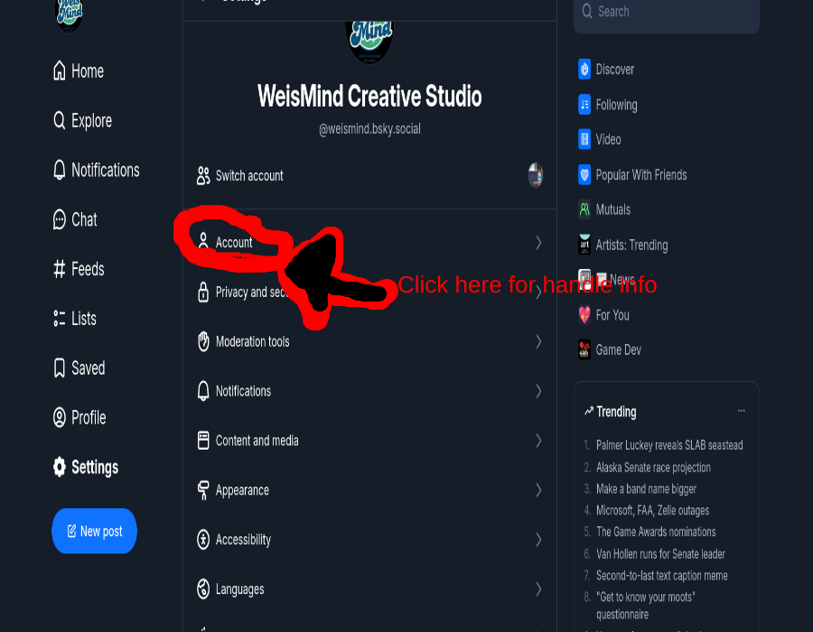
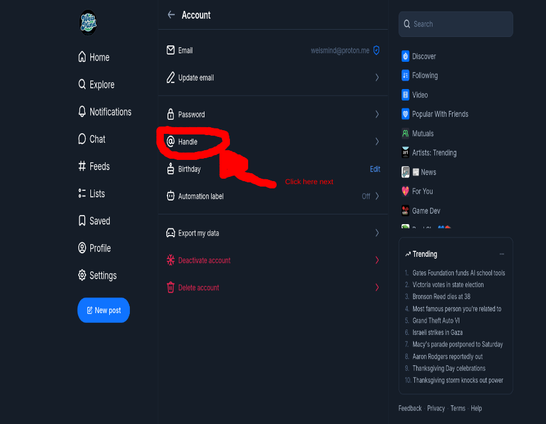
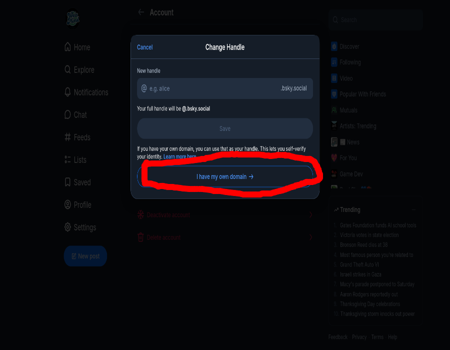
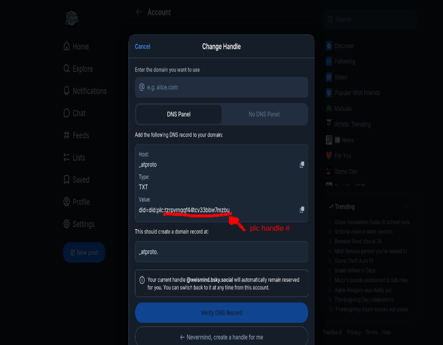

## Bluesky Notes

Bluesky is one of the more popular Fediverse Microblog applications (if not the most popular, I dunno, I should probably look that up). I'm very anti-centralized social media lately, although I'm still lingering on LinkedIn and couple others, so I haven't completely shaken my programming that Billionaires and other corporate, soul-sucking vampires have embedded in my brain - nobody is perfect.

Anyways, I have created a bunch of little recipes, hacks, and tips for any of you Bluesky users out there. Here we go!

## Bluesky Notes

### I. Finding your `dlc` ID

- Sometimes you will need your `dlc` ID to add to a profile section or to share with someone, or maybe even to be able to use a Bluesky application or service. This guide will show you exactly where to find that bad boy without having to hit the API or anything else that's complicated.

1. Login to your Bluesky page and go to the settings section. Click on the "Account" page as shown in the picture below:

2. Next, you will click on the handle setting:

3. Then click on "I have my own domain":

4. See the image where I have underlined the number - that is your plc handle #!

